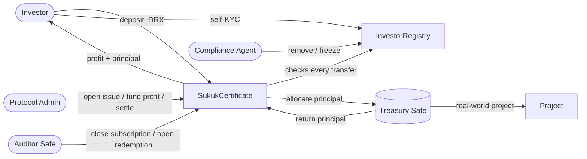

<div align="center">

# Sukuk

**Tokenized Islamic bonds on Ethereum: KYC-gated, Safe-audited, profit-sharing, redeemable.**

[](rwa-sukuk-contracts/contracts)
[](rwa-sukuk-contracts/test)
[](frontend)
[](#deployed-contracts-sepolia)

</div>

---

> **TL;DR:** A Sukuk is an Islamic bond: investors co-own a real project and share its profit
> instead of earning interest. This project runs the whole Sukuk lifecycle on Ethereum, from KYC
> and subscription through profit sharing to redemption, settled in a Rupiah stablecoin (IDRX)
> and overseen by an auditor multisig. Every rupiah can be traced on-chain.

## Contents

[Problem](#the-problem) · [Solution](#our-solution) · [How It Works](#how-it-works) ·
[Features](#features) · [Standards](#standards) · [Architecture](#architecture) ·
[Getting Started](#getting-started) · [Deployed Contracts](#deployed-contracts-sepolia) ·
[Roadmap](#roadmap)

## The Problem

Sukuk is one of the core instruments of Islamic finance. Governments and companies use it to fund
roads, schools, and green projects, and Indonesia regularly offers retail Sukuk to its citizens.
But the way Sukuk is issued and held today has real gaps:

| Pain point | What it means for people |
|---|---|
| **Opaque use of funds** | Investors are told their money funds a project, but can't verify where the principal sits or whether reported profit matches the stated rate. |
| **Many intermediaries** | Issuers, distribution partners, custodians, and registrars each keep their own records. Settlement is slow, and every layer adds cost. |
| **Rigid access** | Fixed subscription windows, minimum ticket sizes, and paperwork keep younger and underbanked investors out. |
| **Manual compliance** | KYC and transfer restrictions are enforced by back offices, not by the instrument itself. |
| **Shariah trust gap** | Compliance depends on trusting off-chain reports. There is no shared, tamper-proof record that profit, not interest, was paid. |

## Our Solution

**Sukuk turns the certificate itself into the source of truth.** The rules of the issue live in
a smart contract that anyone can read, and no single party can bend them.

| Problem | How Sukuk solves it |
|---|---|
| Opaque use of funds | Principal moves only through on-chain calls into a **Gnosis Safe treasury**. Balances, allocations, and returns are public. |
| Many intermediaries | One contract is the registry, the custodian ledger, and the payment rail. Subscription mints the certificate instantly, and profit is claimable the moment it is funded. |
| Rigid access | Connect a wallet, complete KYC in one transaction, and subscribe in **IDRX**, a Rupiah stablecoin, in multiples of the denomination. |
| Manual compliance | **ERC-3643** transfer rules: the token refuses to move to any wallet that is not verified. |
| Shariah trust gap | Profit sits in a separate pool, is never compounded into the principal, and the expected payout per period is published on-chain for the **auditor multisig** to reconcile. |

## How It Works

```
 Connect wallet ─▶ Self-KYC ─▶ Subscribe (IDRX) ─▶ Hold certificate ─▶ Claim profit each period ─▶ Redeem at maturity
```

1. **Verify.** The investor connects a wallet and registers in the on-chain KYC registry.
2. **Subscribe.** The investor deposits IDRX and receives certificates 1:1, each one representing one unit of principal.
3. **Fund the project.** Once the **auditor Safe** closes the subscription, the principal moves to the treasury Safe that finances the real-world project.
4. **Share profit.** Every period the issuer funds the profit pool, and each holder claims their own share.
5. **Redeem.** At maturity the principal returns, the auditor Safe opens redemption, and investors request, receive settlement, and claim their IDRX back.

Every step is a public transaction, and every gate is enforced by role. The two critical transitions
belong to an independent multisig, not the issuer.

## Features

- **Compliant by construction:** only KYC-registered wallets can hold or receive the certificate.
  Investors complete KYC themselves right after connecting a wallet; the agent role can still
  remove, freeze, force-transfer, and recover wallets.
- **Real bond semantics:** ISIN, denomination, issue volume, profit rate, issue and maturity dates
  are all readable on-chain.
- **Donation-proof accounting:** principal is tracked internally, so sending tokens directly
  to the contract cannot move the price.
- **Pull-based profit:** profit sits in a separate coupon pool and is claimed per holder. A
  transfer never carries someone else's unclaimed profit.
- **Two-key governance:** the issuer cannot close the subscription or open redemption alone.
  Those gates belong to an auditor Safe that administers its own role.
- **Role-based dashboard:** separate views for investors, the issuer, the auditor, and the
  compliance desk.

## Standards

| Standard | Role in Sukuk |
|---|---|
| **ERC-7092** | The certificate *is* the bond: ISIN, denomination, profit rate, maturity, `principalOf`. |
| **ERC-4626** | Accounting. 1 certificate = 1 unit of principal, held at 1:1 for the life of the issue. |
| **ERC-7540** | Asynchronous redemption: request → issuer settles → holder claims. |
| **ERC-3643** | Transfer rules and identity registry (reduced T-REX), with freeze and recovery. |
| **Gnosis Safe** | Auditor multisig gates the lifecycle; treasury Safe custodies deployed principal. |

## Architecture



### Lifecycle

```
Subscription ──▶ Active ──▶ Matured ──▶ Redeeming ──▶ Closed
```

| # | Who | Action |
|---|---|---|
| 1 | Investor (or agent) | `selfRegister(country)` · agent: `registerIdentity(investor, onchainId, country)` |
| 2 | Protocol | `openIssue(quota, denomination, tenor, couponRate, couponInterval)` |
| 3 | Investor | `deposit(assets, receiver)` |
| 4 | **Auditor Safe** | `closeSubscription()` → **Active**, tenor starts |
| 5 | Protocol | `allocateToTreasury(amount)` → funds the project |
| 6 | Protocol / Investor | `fundCoupon(amount)` each period, then `claimCoupon()` |
| 7 | Protocol | `returnFromTreasury(amount)`, `markMatured()` → **Matured** |
| 8 | **Auditor Safe** | `openRedemption()` → **Redeeming** |
| 9 | Investor | `requestRedeem(shares, controller, owner)` |
| 10 | Protocol | `fulfillRedeem(controllers)` |
| 11 | Investor | `redeem(shares, receiver, controller)` |

## Repository Structure

```
.
├── rwa-sukuk-contracts/        # Hardhat (TypeScript) smart contracts
│   ├── contracts/
│   │   ├── SukukCertificate.sol        # The bond certificate (7092 + 4626 + 7540 + 3643)
│   │   ├── compliance/InvestorRegistry.sol  # KYC identity registry
│   │   ├── MockIDRX.sol                # Testnet-only IDRX mock
│   │   ├── interfaces/                 # Standard interfaces
│   │   └── SukukVault.sol              # Earlier ERC-4626 vault, kept for reference
│   ├── scripts/                # Deploy + seed scripts
│   └── test/                   # Lifecycle, math, access control, security tests
└── frontend/                   # Next.js dApp (wagmi, viem, RainbowKit, Safe SDK)
    ├── app/                    # Vault, Portfolio, Ledger, Protocol, Auditor, Compliance, Admin
    ├── contracts/              # ABIs + deployed addresses
    └── lib/                    # Contract reads, formatters, Safe integration
```

## Dashboard

| Page | For | What it does |
|---|---|---|
| `/sukuk` | Investors | Self-KYC, issue terms, current phase, subscribe, claim profit, redeem |
| `/portfolio` | Investors | Your position and allocation |
| `/transactions` | Everyone | Full on-chain event ledger, filterable by wallet |
| `/protocol` | Everyone | How the contracts are wired, every call in order, deployed addresses |
| `/auditor` | Auditor Safe | Propose `closeSubscription` / `openRedemption` through the Safe |
| `/compliance` | Agent | KYC register and wallet lookup |
| `/admin` | Protocol | Run the issue: treasury, profit funding, settlement |

## Getting Started

### Prerequisites

- Node.js 20+
- A wallet with Sepolia ETH (for deployment and on-chain testing)

### 1. Smart contracts

```bash
cd rwa-sukuk-contracts
npm install
cp .env.example .env        # fill PRIVATE_KEY, RPC URLs, AUDITOR_MULTISIG, issue terms

npx hardhat compile
npx hardhat test            # full suite
```

Deploy to Sepolia and onboard demo investors (KYC + MockIDRX):

```bash
npm run deploy:certificate:sepolia
SEED_INVESTORS=0xabc...,0xdef... npm run seed:certificate:sepolia
```

> Production terms are a 3-year tenor with profit every 90 days. On a testnet, shorten
> `TENOR_SECONDS` and `COUPON_INTERVAL_SECONDS` in `.env` to walk the full lifecycle in one session.

### 2. Frontend

```bash
cd frontend
npm install
cp .env.example .env.local  # NEXT_PUBLIC_SEPOLIA_RPC_URL, NEXT_PUBLIC_WALLETCONNECT_PROJECT_ID
npm run dev
```

Open [http://localhost:3000](http://localhost:3000). After a fresh deployment, update
`frontend/contracts/addresses.ts` with the new addresses.

## Deployed Contracts (Sepolia)

All contracts are source-verified on Etherscan.

| Contract | Address |
|---|---|
| SukukCertificate | [`0x185e3524Ea9A638122a7d3A6104aCD9112Fce3F7`](https://sepolia.etherscan.io/address/0x185e3524Ea9A638122a7d3A6104aCD9112Fce3F7#code) |
| InvestorRegistry | [`0x016160DE3042C61Db79f1A8af9b317689289fD5b`](https://sepolia.etherscan.io/address/0x016160DE3042C61Db79f1A8af9b317689289fD5b#code) |
| MockIDRX | [`0x6D5f64e820Dd2342F1D08aF439A2902793869e74`](https://sepolia.etherscan.io/address/0x6D5f64e820Dd2342F1D08aF439A2902793869e74#code) |
| Auditor / Treasury Safe | [`0x411E4A576d3cA579e8795559875D1F0684452801`](https://sepolia.etherscan.io/address/0x411E4A576d3cA579e8795559875D1F0684452801) |

Testnet terms: a 30-minute tenor stands in for 3 years (`YEAR_SECONDS=600`), with profit every
5 minutes at 12% a year, so each period pays 6% of principal and the whole lifecycle fits in one session.

## Security

- Role separation: `PROTOCOL_ROLE`, `AGENT_ROLE`, and a self-administered `AUDITOR_ROLE`.
- Reentrancy and malicious-token attacks are tested in `test/SukukVault.security.test.ts`;
  role checks in `test/SukukVault.accessControl.test.ts`.
- `expectedCouponAmount()` publishes what each period *should* pay. The contract cannot know what
  the project actually earned, so the auditor Safe reconciles the two off-chain, with both
  figures public on-chain.
- `MockIDRX` is for testnet only. Set `IDRX_ADDRESS` to use the real token.

> ⚠️ This code has not been professionally audited. Do not use it with real funds.

## Who It's For

- **Retail investors** who want Shariah-compliant yield with a small ticket and full visibility.
- **Issuers** (governments, BUMN, corporates, Islamic banks) that want faster, cheaper issuance with built-in compliance.
- **Auditors and Shariah boards** who need a tamper-proof record instead of periodic reports.
- **Regulators** who can watch the registry, the treasury, and every payout in real time.

## Current Limitations

This is a hackathon prototype on a testnet. We are explicit about what is simplified:

- **KYC is self-attested.** `selfRegister` lets a wallet register itself so the demo can be tried
  end to end. A production deployment would replace this with a licensed KYC provider issuing
  ONCHAINID claims. The registry already follows the ERC-3643 interface, so it can be swapped in
  without touching the certificate.
- **IDRX is mocked.** `MockIDRX` stands in for the real IDRX token on Sepolia.
- **Profit is reported, not proven.** The contract publishes what each period should pay. Checking
  that against the project's real earnings is still an off-chain job for the auditor Safe.

## Roadmap

- [x] Certificate combining ERC-7092, ERC-4626, ERC-7540, and ERC-3643
- [x] Auditor and treasury Gnosis Safes gating the lifecycle
- [x] Role-based dashboard for investors, issuer, auditor, and compliance
- [x] Self-service KYC on connect
- [ ] Integrate a licensed KYC provider (ONCHAINID claims)
- [ ] Switch to the official IDRX token
- [ ] Compliant secondary market between verified holders
- [ ] On-chain project reporting and proof of profit from the treasury
- [ ] Independent smart contract audit, then mainnet / L2 deployment

## Tech Stack

**Contracts:** Solidity, Hardhat, OpenZeppelin Contracts v5, TypeScript
**Frontend:** Next.js 16, React 19, wagmi, viem, RainbowKit, Safe Protocol Kit, Tailwind CSS v4

---

<div align="center">
Built by <a href="https://github.com/riyqnn">@riyqnn</a>
</div>
